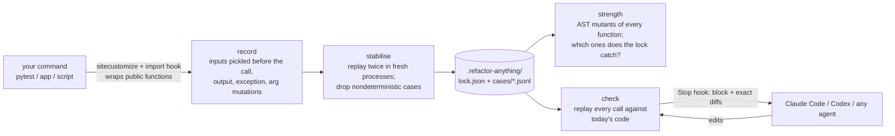

<h1 align="center">refactor-anything</h1>

<p align="center"><b>Let your coding agent refactor any Python code, and prove it still behaves the same.</b><br>
Record what your functions really do from a run you already have (tests, app, script). After every edit, replay those exact calls.<br>
Claude Code cannot stop with "done" while a single recorded call behaves differently.</p>

<p align="center">
  <a href="https://github.com/Prime-agentai/refactor-anything/actions/workflows/ci.yml"></a>
  
  
  
  <a href="LICENSE"></a>
</p>

```console
$ refactor-anything record invoice -- python3 -m unittest -q
recorded 7 new calls (0 unstable, left out) into .refactor-anything/
  invoice:label      4         0
  invoice:total      3         0

$ refactor-anything strength
   75%  invoice:total  9/12 mutants caught
survivors (behaviour could change here and the lock would not notice):
  invoice.py:4:12  total: `<` -> `<=`    if qty < 0:
  invoice.py:4:18  total: `0` -> `1`    if qty < 0:
  invoice.py:7:40  total: `2` -> `3`    return round(subtotal * (1 + tax), 2)
lock strength 83%: 15/18 mutants caught

$ refactor-anything record invoice -- python3 more.py     # one more input: an order line with qty 0
$ refactor-anything strength
lock strength 94%: 17/18 mutants caught

$ # ...the agent "tidies" `qty < 0` into `qty <= 0`...
$ refactor-anything check
  ok   invoice:label  4/4
  DIFF invoice:total  3/4
- invoice:total [exception]: expected returned 4.5, got raised ValueError: negative quantity
FAIL  7/8 recorded calls match
```

Agents are good at making code *look* cleaner. The risk is the change that nobody asked for: a `<`
that became `<=`, an error message that changed wording, a list that is now sorted in place, a
generator that yields one item more. Tests miss these when the tests are thin, and in code that
needs refactoring the tests usually are thin.

**refactor-anything turns the code's current behaviour into the test.** It does not ask the agent to
be careful. It checks.

## Quickstart (30 seconds)

Install nothing: [`uv`](https://docs.astral.sh/uv/) runs it straight from GitHub.

```bash
alias refactor-anything='uvx --from git+https://github.com/Prime-agentai/refactor-anything refactor-anything'

cd your-project
refactor-anything record yourpkg.module -- python -m pytest -q   # or any command that exercises the code
refactor-anything strength                                       # what would the lock miss?
refactor-anything install claude                                 # Stop hook + edit guard + skill
# now ask Claude Code to refactor; or let the loop drive it:
refactor-anything go "split parse_config into small functions"
```

Python 3.11+ and nothing else. The tool runs in its own environment and records your project with
*your* interpreter and *your* dependencies: the `python` on your PATH, your active venv.

## How it works



1. **`record`** runs your command with a `sitecustomize` that installs an import hook. Each
   public function and method in the target module is wrapped (plain functions, methods,
   `@staticmethod`, `@classmethod`, `@property` getters and generators). Every distinct call is
   saved: the **input, pickled *before* the call** (so in-place edits cannot leak into it), the
   **return value or exception**, and the **state of the arguments after the call**, so sorting a
   list in place or mutating `self` is part of the locked behaviour. Child Python processes inherit
   the recorder and write their own files. This is tested with `subprocess.run([sys.executable, ...])`.
2. **Stabilise.** Every new case is replayed twice, in fresh processes, against the code that
   produced it. Cases that differ (`random`, time, hash order, ids) are marked unstable and left
   out, so a `check` failure is about your change and never about flakiness.
3. **`check`** replays every stable case against the current code in one subprocess and compares
   canonical values. Dict and set order is ignored, as Python's `==` ignores it. `1` is not `1.0`
   and a tuple is not a list. Objects are compared by class and state, not by `id`.
4. **`strength`** asks the question the green check cannot answer: *would this lock notice a bug?*
   It makes small AST mutants of every function (`<`→`<=`, `+`→`-`, `and`→`or`, `n`→`n+1`, a
   dropped `.strip()`, `return None`, ...), replays the lock against each one in parallel, and lists
   every **survivor** with `file:line:col`. A survivor is either a line you have no recorded input for, or an
   equivalent mutant that cannot change behaviour. Either way, you now know.

## What gets locked, and what does not

| Construct | Locked as |
|---|---|
| function / method / staticmethod / classmethod / property | return value or exception (type and message), plus the argument state after the call |
| generator function | the items **the caller actually consumed**, in order, and whether it stopped. Values passed in with `send()` are replayed too |
| function returning a generator | the same as a generator function. The returned generator is wrapped lazily and stays a generator |
| function returning `map`/`zip`/`islice`/... | its items. They are filled in after recording by re-running the original on the same input, up to 1,000 items, and an exception raised part-way is locked as well |
| `_private` helpers | **not locked by default.** They are yours to rename, split or merge. `--private` locks them too |
| a removed public function or class | reported as `missing` / `load-error` |
| inputs that cannot be pickled (lambdas, open files, generators) | skipped, and reported per function. Every other call is still kept |
| async functions | not yet (see the roadmap) |

## Claude Code

```bash
refactor-anything install claude          # .claude/settings.json (or --local) + .claude/skills/refactor-anything
```

- **Stop hook.** When the agent tries to finish and a locked module has changed, the lock is
  replayed. If anything differs, the stop is blocked and the agent gets the exact cases:
  `expected 'TOTAL: 0', got 'TOTAL: 0.00'`. If the code has not changed since the last block (the
  agent decided the change is intended and is reporting it), the hook lets it stop with a notice.
  It never blocks more than 3 times in a session. When nothing locked was touched, it does nothing
  and costs no replay.
- **Edit guard.** A PreToolUse hook denies `Write`/`Edit`/`MultiEdit`/`NotebookEdit` inside
  `.refactor-anything/`. Shell edits are caught by a checksum: `check` reports `TAMPERED` and exits 3.
- **Skill.** It tells the agent to record before editing, read `strength`, and never re-record to make a check pass.

These are measured live runs (Claude Code 2.1.330, haiku), in [docs/live-claude-code.md](docs/live-claude-code.md):
- `go` refactored a 41-line nest of `if`s into a discount table plus helpers: **46/46 recorded calls
  matched, round 1, 46 s**. The agent kept `member == True` on purpose, because truthiness would price
  `member=2` differently.
- The agent was asked for a "refactor" that quietly changed output (`:.2f`). It tried to stop, the hook
  blocked with the two differing cases, and the agent reported them as the requested change
  without touching the lock.

## `go`: the loop is code, not a prompt

```bash
refactor-anything go --agent claude --model haiku --rounds 3 "flatten the nested ifs in price()"
refactor-anything go --agent codex "..."
refactor-anything go --agent "./my-agent.sh" "..."     # any command; the task arrives on stdin
```

The loop checks that the lock passes before the agent starts and fingerprints the recording. It
runs the agent and replays. If a case fails, it sends the diff back to the agent until the lock
passes or the rounds run out. Claude gets the follow-up with `--resume` on the same session. The
diff-feedback round is covered by tests with a scripted agent; the live Claude run passed in round 1,
so `--resume` has not been exercised live yet. **If the agent edited the recording,
the run is rejected (exit 3).**

## Real world: more-itertools

The test suite of [more-itertools](https://github.com/more-itertools/more-itertools)
(`aa99776`, 936 tests) was recorded on `more_itertools/recipes.py`. Full write-up:
[docs/real-world.md](docs/real-world.md).

| | |
|---|---|
| record (runs the 936 tests once) | 59.3 s wall time. The suite alone takes 52.0 s |
| locked | **1,717 calls** across 55 recipes, 51 unstable left out. `random_*` was detected on its own |
| `check` | **1,666 calls replayed in 0.94 s** (1.56 s wall) |
| `strength` on 7 recipes | 73/83 mutants caught (88%), 50.8 s on 6 CPUs |

Three of the ten survivors are **real bugs that the upstream test suite would not catch either**:
in `factor`, changing `n < 211**2` to `<=` makes `factor(44521)` return `[44521]` instead of
`[211, 211]`. The other survivors are equivalent mutants, for example a size threshold that only
switches between two algorithms with the same output.

## Commands

| command | what it does | exit |
|---|---|---|
| `record <module[:f,Cls.m]>... -- <cmd>` | record real calls. It appends to an existing lock if the code still passes it, and `--fresh` starts over. `--cap` sets the cases kept per function (default 200) | 0 / 2 |
| `check [--json] [--markdown]` | replay the lock. `--markdown` gives a PR comment | 0 pass, 1 diff, 2 error, 3 tampered |
| `strength [--function f] [--min 80]` | mutant kill rate and survivors with `file:line:col` | 0, or 1 below `--min` |
| `status` | what is locked, unstable, unpicklable or never called | 0 |
| `go "<goal>" --agent claude\|codex\|<cmd>` | the agent refactors and is held to the lock | 0 / 1 / 3 |
| `install claude [--local]` | Stop hook, edit guard and skill, merged into existing settings | 0 |

Commit `.refactor-anything/lock.json` and `cases/` if you want CI to hold every PR to the same
behaviour: `refactor-anything check --markdown >> "$GITHUB_STEP_SUMMARY"`.

## Limits (read these)

- **The recording is only as good as the command you ran.** A branch no call reaches is not locked.
  That is exactly what `strength` surfaces, so read the survivors before a big refactor.
- **Security:** cases store inputs as pickles, and `check` unpickles them. Treat `.refactor-anything/`
  like code: replay only recordings you or your CI made, not ones from an untrusted fork.
- Inputs are compared after the call, so a function that intentionally keeps references to its
  inputs, or that depends on the outside world (files, network, clock), is either marked unstable or
  locked to what happened during the recording. The tool does not mock anything.
- Instance methods replay with the recorded `self`. A refactor that renames a class's *private*
  attributes changes the object's state, so it is reported as a difference.
- Mutation testing re-executes the target module's top level once per mutant. Modules with heavy
  import-time side effects will be slow there. Each mutant runs in its own process with a timeout
  and a memory cap (Linux).
- Python only. Codex and custom agents are driven through `go`. Only Claude Code has the native
  hooks, and only Claude Code was tested live.

## Roadmap

- [ ] `pytest` plugin: `pytest --lock mypkg.text` records without a separate command
- [ ] async functions and async generators
- [ ] `record --inputs file.jsonl` and `strength --suggest`: propose inputs that kill the survivors
- [ ] diff-aware `strength`: mutate only the functions a branch changed
- [ ] Codex and Gemini CLI native hook adapters
- [ ] JS/TS front end with the same lock format

## Develop

```bash
bash scripts/check.sh     # mypy --strict, 44 tests, and the CLI end to end on a scratch project
```

MIT licensed. Built by [Prime-agentai](https://github.com/Prime-agentai). The idea of proving a change by replaying the
original's recorded behaviour is the same one [rust-anything](https://github.com/erkamyaman/rust-anything)
and [fast-anything](https://github.com/EL4CTEO/fast-anything) use for Rust ports. refactor-anything
applies it to the everyday case, a refactor in the same language, and adds the mutation score that
tells you how much the recording can actually see.
